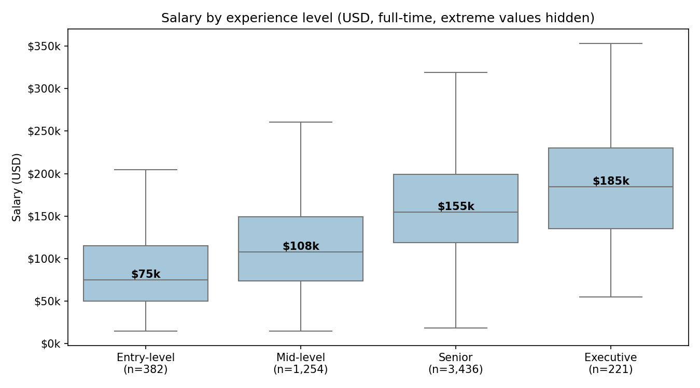
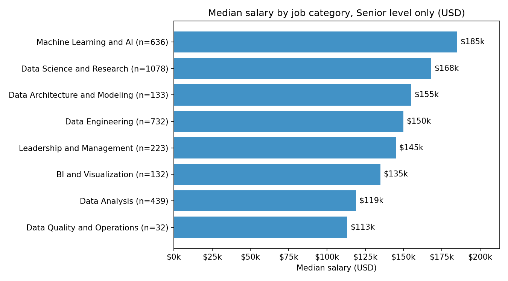
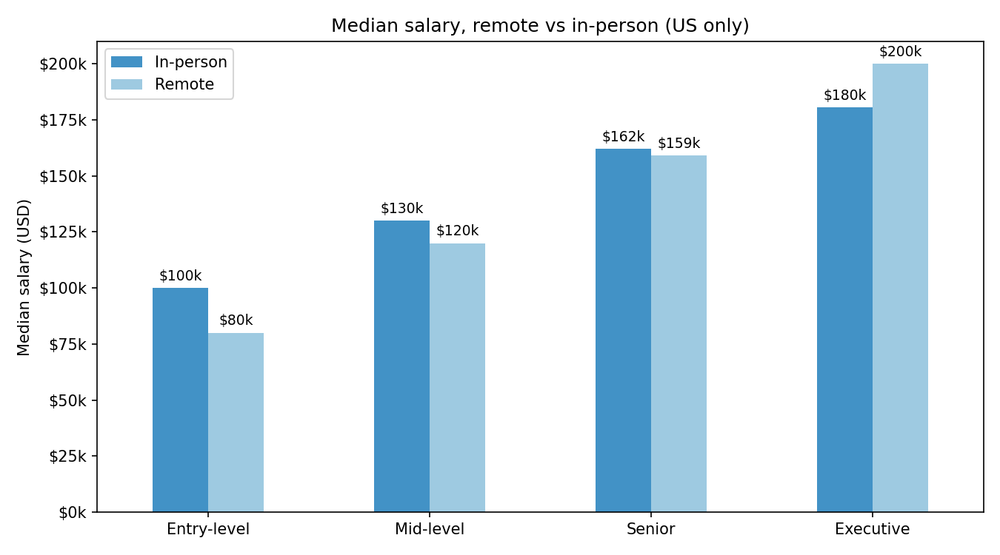
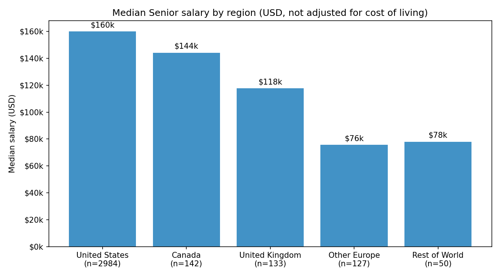
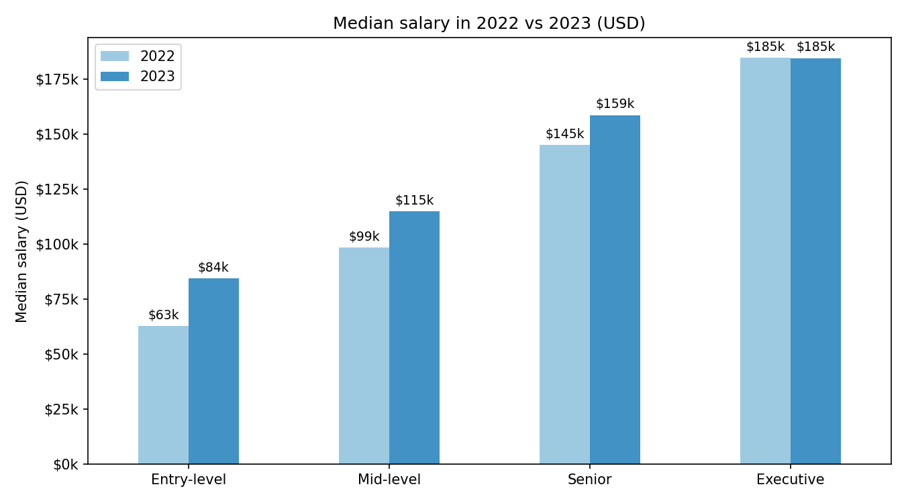

# What Drives Salaries in Data Jobs?

An analysis of **5,293 data-science salaries (2020–2023)**: how experience, job type, location and remote work affect pay, followed by a salary prediction model.

**Tools:** Python · Pandas · Matplotlib · Seaborn · SciPy · scikit-learn

---

## Key findings

1. **Experience roughly doubles pay.** The median salary rises from **\$75k** at entry level to **\$155k** at senior level (+107%).
2. **ML & AI roles pay the most.** At the same (senior) level, Machine Learning & AI earns a median of **\$185k**, about **55% more** than Data Analysis (\$119k).
3. **Remote work costs juniors, not seniors (US).** Remote roles pay **−20% at entry level** and **−8% at mid-level** (statistically significant). At senior level the gap almost disappears (−2%).
4. **Location matters as much as role.** A senior professional in the US earns a median of **\$160k**, about **double** the median in the rest of Europe (\$76k). These figures are not adjusted for cost of living.
5. **The "2023 salary jump" is mostly an illusion.** Overall medians rose up to +35% from 2022 to 2023. But 2023 contains more US jobs (84% vs 77%), and **within the US the real increases were only +2% to +9%**. This is a composition effect, not pay growth.

---

## 1. Experience level



| Level | Median salary |
|---|---|
| Entry-level | \$75k |
| Mid-level | \$108k |
| Senior | \$155k |
| Executive | \$185k |

The boxes overlap a lot: a top-quarter mid-level salary (~\$150k) is close to a typical senior salary. Experience matters, but job type and location explain much of the rest. See below.

## 2. Job category (senior level only)



To compare jobs fairly, I compared **senior-level roles only**, so differences come from the job and not from seniority. Categories with fewer than 30 people were excluded.

- **Machine Learning & AI** (\$185k) and **Data Science & Research** (\$168k) pay the most.
- **Data Analysis** (\$119k) and **Data Quality & Operations** (\$113k, small sample n=32) pay the least.
- **Leadership & Management** (\$145k) ranks lower than expected. This group mixes many different titles, and executives are counted separately as an experience level.

## 3. Remote vs in-person (US only)



US only, to keep country out of the comparison. Hybrid was excluded because it has very few rows. Significance was tested with the **Mann-Whitney U test**, which suits skewed salary data.

| Level | In-person | Remote | Difference | p-value |
|---|---|---|---|---|
| Entry-level (n=231) | \$100k | \$80k | −20% | 0.001 |
| Mid-level (n=844) | \$130k | \$120k | −8% | 0.007 |
| Senior (n=2,973) | \$162k | \$159k | −2% | 0.038 |
| Executive (n=189) | \$180k | \$200k | +11% | 0.063 (not significant) |

Remote work comes with a pay penalty early in a career, which shrinks with seniority. The senior gap is statistically detectable but very small in practice. The executive difference could be chance.

## 4. Location (senior level)



| Region | Median | vs US |
|---|---|---|
| United States (n=2,984) | \$160k | — |
| Canada (n=142) | \$144k | −10% |
| United Kingdom (n=133) | \$118k | −26% |
| Other Europe (n=127) | \$76k | −53% |
| Rest of World (n=50) | \$78k | −51% |

Salaries are converted to USD and **not adjusted for cost of living, taxes or benefits**, so higher pay does not automatically mean better off.

## 5. 2022 vs 2023: a composition effect



| Level | All data | US only |
|---|---|---|
| Entry-level | +35% | +8% |
| Mid-level | +17% | +2% |
| Senior | +9% | +9% |
| Executive | 0% | −6% (2022: n=38) |

The overall numbers suggest big raises. But the share of US jobs grew from **77% to 84%**, while lower-paying regions shrank. Within the US, salaries rose only modestly. Most of the apparent jump comes from **which countries are in the data**, not from pay rises.

---

## Salary prediction model

**Goal:** predict `salary_in_usd` from experience level, job category, region, work setting, company size and year.

**Setup:**
- 80/20 train/test split, stratified by experience level, plus 5-fold cross-validation;
- one-hot encoded features (0/1 columns), with one reference category per feature (US, Entry-level, Data Analysis, In-person, medium company, 2023);
- models trained on log(salary), because salaries are skewed.

| Model | Test MAE | Test R² | CV MAE | vs baseline |
|---|---|---|---|---|
| Baseline: median by job category + level | \$43,846 | 0.258 | — | — |
| **Linear regression** | **\$40,038** | **0.354** | **\$40,550** | **−8.7%** |
| Random Forest | \$40,324 | 0.346 | \$41,191 | −8.0% |
| Gradient Boosting | \$40,203 | 0.343 | \$40,837 | −8.3% |

**Results:**
- **All three models beat the baseline by 8–9%**, and their cross-validation scores match the test scores, so the results are stable.
- **The complex models add nothing over linear regression**, which has the lowest error on both cross-validation and the test set, so I chose it. It's also the simplest and easiest to interpret. With only broad categorical features, salary behaves almost additively.
- **What drives predictions:** on log(salary), each linear-regression coefficient reads as a percentage. With everything else held equal, the model estimates: **UK −29%, Canada −10% and rest of Europe −51% vs the US**; **Senior +66% and Executive +97% vs entry level**; **ML & AI +54% vs Data Analysis**. Year, work setting and company size matter little. This matches the analysis above.

**Limitations:**
- **R² ≈ 0.36 means most of the salary variation is not explained.** The dataset has no company names, skills, education or negotiation, which strongly affect pay.
- **An MAE of about \$40k** (roughly 28% of a typical salary) makes the model useful for ballpark estimates, not for predicting an individual offer.

---

## Data & cleaning

**Source:** [Jobs and Salaries in Data Science](TODO-kaggle-dataset-link) on Kaggle (9,355 rows, 12 columns; salaries for 2020–2023).

| Step | Rows | Why |
|---|---|---|
| Raw data | 9,355 | |
| Removed exact duplicates | 5,341 | 43% of rows were identical. Duplicates would leak between train and test sets and inflate model scores. |
| Kept full-time jobs only | 5,296 | Part-time, contract and freelance pay isn't comparable (only 45 rows). |
| Removed 3 implausible salaries | **5,293** | Checked by hand: e.g. an "Executive" in Canada earning \$15k, and UK mid-level roles at \$430k. |

Other decisions:
- **Dropped `salary` and `salary_currency`.** The target is `salary_in_usd`; local salary would leak the answer, and currency mostly reveals the country.
- **Grouped 70 countries into 5 regions.** 86% of rows are from the US, so most countries are too small to compare on their own.
- **Kept other extreme values.** Very low salaries come from lower-cost countries, and very high ones from US big tech. They're unusual, not wrong. Medians are used throughout because they aren't pulled by extremes.
- **Compared within the same experience level** (and the same country where relevant), so results aren't mixed up by differences in seniority or location.

**Dataset limits:** salaries are self-reported, and the data is **US-heavy (81%)** and **senior-heavy (65%)**. Findings describe this sample and may not generalize, for example to Indonesia.

---

## Repository structure

```
jobs_salary_analysis.ipynb   cleaning, the 5 questions, significance tests and the salary model
images/                      charts used in this README
requirements.txt
```

## Run it

```bash
pip install -r requirements.txt
```

Download `jobs_in_data.csv` from Kaggle, set `DATA_PATH` at the top of the notebook, then run all cells.
